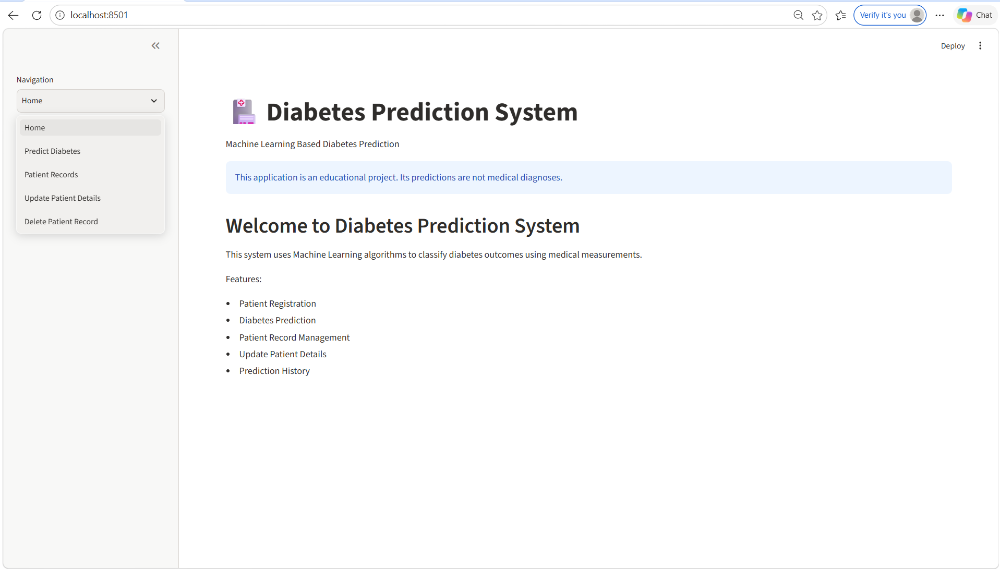
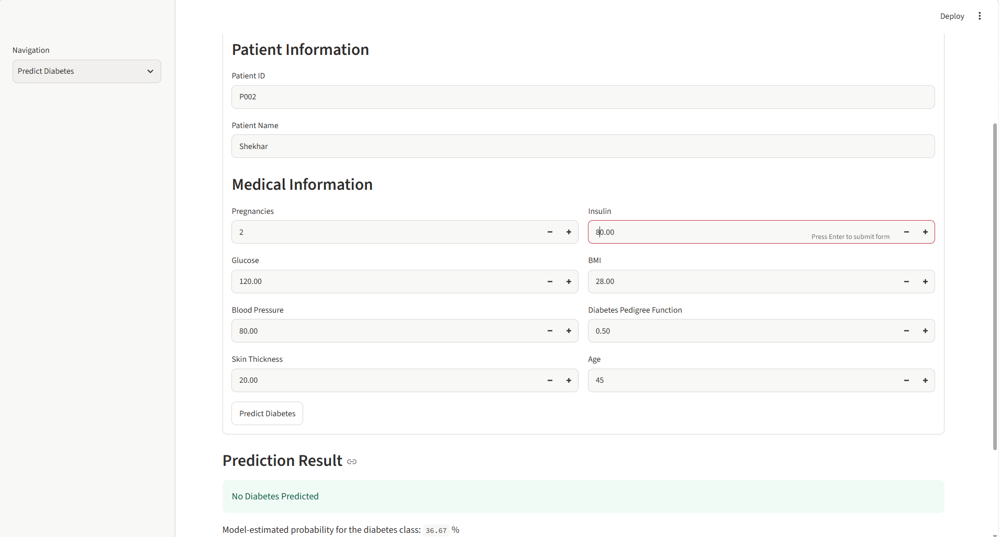
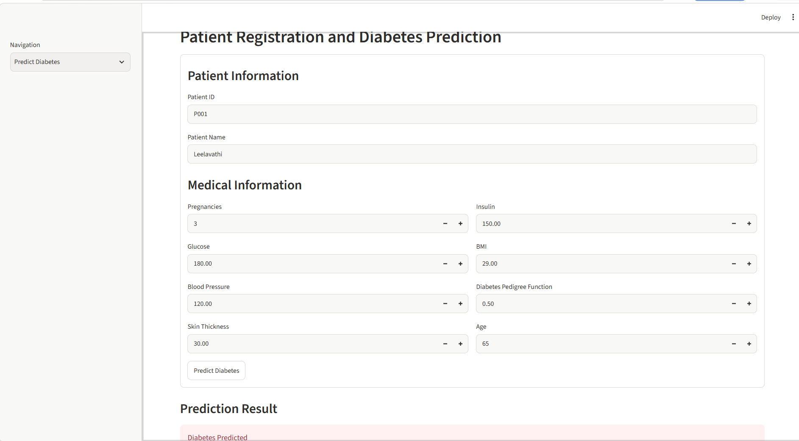

# Diabetes Prediction System

**CodeAlpha Machine Learning Internship – Task 4**

1. Project Overview

Diabetes Prediction System is a machine-learning project that uses selected medical attributes to estimate whether a record is classified as diabetic or non-diabetic by a trained model.

The project includes a Streamlit web application where users can enter sample patient details, view model predictions, access saved records, update patient details and delete records.


2. Objectives

- Prepare and process a diabetes dataset.
- Train and compare multiple machine-learning classification algorithms.
- Select and save the best-performing model based on the evaluation performed in the training script.
- Build a web interface for entering sample data and viewing predictions.
- Demonstrate basic patient-record management, including viewing, updating and deleting records.

3. Dataset

The project uses the Pima Indians Diabetes Dataset.

Dataset source:
https://raw.githubusercontent.com/plotly/datasets/master/diabetes.csv

The dataset contains the following features:

- Pregnancies
- Glucose
- BloodPressure
- SkinThickness
- Insulin
- BMI
- DiabetesPedigreeFunction
- Age

The target column is `Outcome` (0 or 1).

The dataset represents a specific study population and has limitations. Its results may not generalize to other populations.

4. Machine Learning Algorithms

The training script compares three classification algorithms:

- **Logistic Regression:** Estimates the probability of a record belonging to a particular class.
- **Random Forest:** Uses multiple decision trees to make predictions.
- **Support Vector Machine (SVM):** Finds a decision boundary between different classes.

The model selected by the training script is saved for use in the Streamlit application.

5. Data Preprocessing and Evaluation

The training script performs the following operations:

- Replaces zero values in selected columns (Glucose, BloodPressure, SkinThickness, Insulin and BMI) with missing values.
- Uses median imputation to handle missing values.
- Scales features for Logistic Regression and SVM.
- Splits the dataset into training and testing sets.
- Evaluates models using accuracy and classification reports.
- Generates a model-accuracy comparison chart.
- Generates a confusion matrix for the selected model.
6. Application Features

The Streamlit web application provides the following features:

- **Home:** Displays the project introduction.
- **Predict Diabetes:** Allows users to enter sample patient details and obtain a model prediction.
- **Patient Records:** Displays saved sample patient records.
- **Update Patient Details:** Allows users to edit existing records and recalculate predictions.
- **Delete Patient Record:** Allows users to delete selected records with confirmation.

Patient records are stored locally in `patient_records.csv`.

7. Project Structure

```text
CodeAlpha_Diabetes_Prediction/
│
├── diabetes_prediction.py
├── app.py
├── diabetes_model.pkl
├── diabetes_model_comparison.png
├── diabetes_confusion_matrix.png
├── patient_records.csv
├── README.md
│
└── screenshots/
    ├── home_page.png
    ├── diabetic_result.png
    └── non_diabetic_result.png
```

Note: `patient_records.csv` is created when records are saved.

8. Technologies and Requirements

- Python
- NumPy
- Pandas
- Matplotlib
- Scikit-learn
- Joblib
- Streamlit

Install the required packages using:

```bash
python -m pip install numpy pandas matplotlib scikit-learn joblib streamlit
```

9. How to Run the Project

**Step 1: Open the project folder**

Open `CodeAlpha_Diabetes_Prediction` in VS Code.

**Step 2: Train the model**

Run the following command:

```bash
python diabetes_prediction.py
```

This downloads the dataset, trains and evaluates the models, and generates the trained model and evaluation images.

**Step 3: Start the Streamlit application**

Run:

```bash
python -m streamlit run app.py
```

Streamlit will display a local URL in the terminal. Open that URL in your browser to access the application.

Note: Run the training script before starting the application if `diabetes_model.pkl` has not been created.

 10. Project Screenshots

### 1. Home Page



### 2. Diabetes Prediction



### 3. No Diabetes Prediction



11. Limitations

- This is an educational demonstration, not a clinically validated prediction system.
- The dataset is limited and may not represent all populations.
- Model performance on a test dataset does not guarantee accurate predictions for new records.
- Patient records are stored in a local CSV file and are not protected like records in a secure healthcare system.
- Real personal or medical information should not be entered into this demonstration application.

12. Conclusion

This project demonstrates a machine-learning workflow involving dataset preparation, preprocessing, model training, model comparison, evaluation and saving a trained model.

It also demonstrates how machine learning can be integrated with a Streamlit web application, along with basic patient-record management features.

The project was developed as part of the CodeAlpha Machine Learning Internship – Task 4.
13. Project Demo

[Watch Diabetes Prediction System Demo](https://drive.google.com/file/d/1SwvGXFRdVswfZ8AIy7cyDN6pvb6GM-LD/view?usp=drive_link)